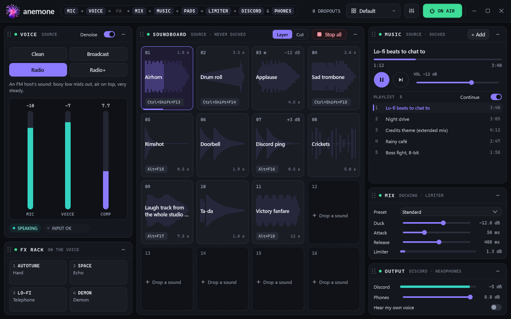
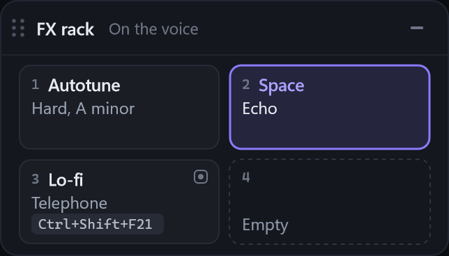

# Anemone

**An audio control room for Discord and games: a clean, present voice, a rack of voice effects, sound pads and a music player.**

[Français : guide d'installation](guide-fr.md)

Anemone sits between your microphone and your voice chat. It cleans up your voice and gives it presence,
even with a modest microphone or an imperfect setup. It mixes in music and sound pads, adds voice
effects on hotkeys, and sends the result to Discord or an in-game voice chat as if it were a plain
microphone.

  

## What it does

- **Voice**: DeepFilterNet noise removal, then a broadcast-style chain (leveling, EQ, compression, de-essing, limiting) with four characters: *Clean*, *Broadcast*, *Radio* and *Radio+*.
- **FX rack**: four slots of voice effects in series (drag a slot to move it in the chain, the others make room), on hotkeys, in Hold or Toggle mode: *Autotune* (hard, soft or max), *Space* (echo, reverb or canyon), *Lo-fi* (telephone, megaphone, or a push-to-talk walkie-talkie with its squelch) and *Demon*.
- **Soundboard**: 16 pads with their own sound, volume and hotkey, in *Layer* or *Cut* mode. Silence at the start and end of a sound is trimmed, so a pad fires at once.
- **Music**: a playlist that stays, which ducks under your voice.
- **Your own VST3 effects** in the rack's slots, next to the built-in ones, found in your plugin folders (FL Studio's folders can be imported). VST3 only; Waves plugins are skipped.
- **Windows' microphone, optionally**: while Anemone runs it can make the cable Windows' default microphone, so apps without a microphone setting (a browser tab, some games) hear your processed voice; quitting gives your microphone back.
- **Mix and output**: one limiter before the call; your headphones get their own level, with your own voice optional.
- A rearrangeable window with layout presets, global hotkeys, and a tray icon to keep it running.
- Interface in **English and French**, following your Windows language.

  

## Download and install

1. You need **Windows 10 or 11, 64-bit**.
2. Install **VB-Cable**, free, from [vb-audio.com/Cable](https://vb-audio.com/Cable/). It is a separate product and is not bundled with Anemone. Restart if its installer asks you to.
3. **Download** [`Anemone-windows-x64.zip`](https://github.com/Yanis-A/anemone/releases/latest/download/Anemone-windows-x64.zip), unzip it anywhere and run `Anemone.exe`. There is no installer.

> **Windows protected your PC?** Anemone is not code-signed, so SmartScreen may warn you the first time. Click **More info**, then **Run anyway**.

## Set up Discord

1. **In Anemone**, open the devices panel (the sliders icon in the header) and check:
   - **Microphone**: your microphone;
   - **Headphones**: your headphones or speakers;
   - **Call output**: `CABLE Input (VB-Audio Virtual Cable)`.
2. **In Discord**, open *User Settings*, then *Voice & Video*:
   - **Input device**: `CABLE Output (VB-Audio Virtual Cable)`;
   - **Output device**: your headphones, as usual;
   - **Input profile**: **Studio** (pure audio, no processing). Anemone already removes the noise and sets the level; Discord's own processing on top would degrade your voice, the music and the pads.
3. Click **Let's check** to hear yourself as others hear you.

In a game with its own voice chat, pick `CABLE Output` as the microphone, and turn the game's noise suppression off if it has one.

### Good to know

- **Mute**: the **ON AIR** button in Anemone's header (On/Off, with a global hotkey) cuts everything sent to the call.
- **Hear yourself**: turn on *Hear my own voice* in the Output panel.
- **Your PC's sound went silent after installing VB-Cable?** Windows sometimes makes the cable the default device. Press Win+R, type `mmsys.cpl`, and set your own speakers or headphones (*Playback*) and microphone (*Recording*) back as the default devices. Never set `CABLE Input` as the default output: everything your PC plays would go to the call.
- Closing the window keeps Anemone running in the notification area. Settings are kept in `%APPDATA%\Anemone\settings.json`.

## Credits

Anemone is free to use. Made by **yvvid**.

| Project | Use | Licence |
| --- | --- | --- |
| [JUCE](https://juce.com) | Application framework | JUCE licence |
| [DeepFilterNet](https://github.com/Rikorose/DeepFilterNet) by Hendrik Schröter | Voice noise removal | MIT or Apache-2.0 |
| [VB-Cable](https://vb-audio.com/Cable/) by VB-Audio | Virtual audio cable to the call app | External, installed separately |

The full third-party notices are in [`THIRD-PARTY-NOTICES.txt`](THIRD-PARTY-NOTICES.txt), also inside the download.
