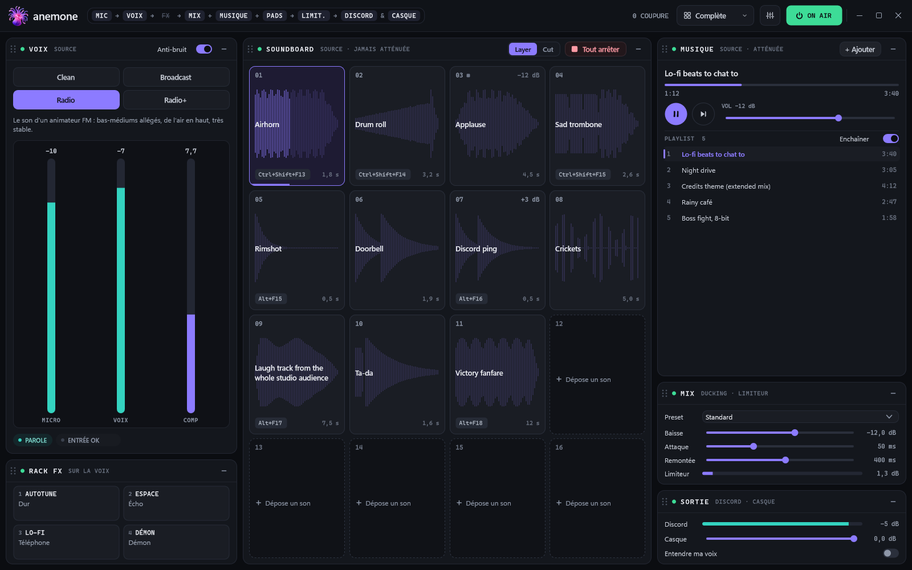

# Anemone : installation et réglages

Anemone se place entre ton micro et ton chat vocal. Il nettoie ta voix et la met en avant, ajoute la musique, les pads de sons et des effets, puis envoie le tout à Discord ou au chat vocal d'un jeu, comme un micro ordinaire. Son interface est en français quand Windows l'est.

  

## 1. Installer

1. Il te faut **Windows 10 ou 11, en 64 bits**.
2. Installe **VB-Cable**, gratuit, depuis [vb-audio.com/Cable](https://vb-audio.com/Cable/). C'est un câble audio virtuel : Anemone envoie le son dedans, et Discord l'écoute comme un micro. Il n'est pas fourni avec Anemone. Redémarre si son installateur te le demande.
3. Télécharge [`Anemone-windows-x64.zip`](https://github.com/Yanis-A/anemone/releases/latest/download/Anemone-windows-x64.zip), décompresse-le où tu veux et lance `Anemone.exe`. Il n'y a pas d'installateur.

> **« Windows a protégé votre ordinateur » ?** Anemone n'est pas signé, alors SmartScreen peut prévenir au premier lancement. Clique sur **Informations complémentaires**, puis **Exécuter quand même**.

## 2. Régler Anemone

Ouvre le panneau des appareils (l'icône des curseurs, en haut) et vérifie :

- **Micro** : ton micro ;
- **Casque** : ton casque ou tes enceintes ;
- **Sortie d'appel** : `CABLE Input (VB-Audio Virtual Cable)`.

## 3. Régler Discord

Ouvre les **Paramètres utilisateur** (la roue dentée, en bas à gauche), puis **Voix et vidéo** :

- **Périphérique d'entrée** : `CABLE Output (VB-Audio Virtual Cable)` ;
- **Périphérique de sortie** : ton casque, comme d'habitude ;
- **Profil d'entrée audio** : **Studio** (audio pur, sans aucun traitement).

Le profil Studio compte beaucoup : Anemone retire déjà le bruit et règle le niveau. Le traitement de Discord par-dessus abîmerait ta voix, la musique et les pads.

Clique sur **Vérifions** pour t'entendre comme les autres t'entendent.

Dans un jeu qui a son propre chat vocal, choisis `CABLE Output` comme micro, et coupe sa suppression de bruit s'il en a une.

## Les effets

Le panneau Rack FX a quatre emplacements, traversés dans l'ordre des chevrons (de 1 à 4) ; glisse une tuile pour la déplacer dans la chaîne, les autres lui font de la place. Un effet en *Bascule* laissé allumé le reste au prochain lancement. Un clic allume ou éteint un effet, et le clic droit choisit l'effet, sa variante, son intensité, son raccourci et son mode : *Bascule* (un appui allume, le suivant éteint) ou *Maintien* (actif tant que tu tiens la touche).

Pour le talkie-walkie du RP : choisis la variante *Walkie* du Lo-fi (elle passe d'elle-même en *Maintien*) et donne-lui un raccourci. Tu parles en tenant la touche, et le « kssht » part quand tu la relâches.

## Tes plugins VST3

Dans le panneau des appareils, section *Plugins (VST3)* : ajoute tes dossiers de plugins (ou coche *Reprendre les dossiers de FL Studio*), puis *Rechercher mes plugins (VST3)*. Ils apparaissent ensuite dans le clic droit d'une tuile du rack, *Effet* › *VST3* ; *Ouvrir l'interface* montre leur fenêtre. Seuls les VST3 sont pris en charge, et les plugins Waves sont écartés.

## Les applis sans réglage de micro

Un onglet de navigateur ou certains jeux prennent le micro de Windows sans demander. Coche *Devenir le micro de Windows quand Anemone tourne* dans le panneau des appareils : tant qu'Anemone tourne, ces applis entendent ta voix traitée. Quand tu le quittes, ton micro revient.

## Carte son à plusieurs entrées

Si ton entrée a deux canaux (par exemple « Analogue 1/2 »), choisis le bon dans *Canal d'entrée* : *1* si ton micro est branché sur l'entrée 1. En cas de souci, le lien *Ouvrir le journal des appareils* montre ce que la carte a vraiment donné.

## Bon à savoir

- **Te couper** : le bouton **ON AIR** en haut d'Anemone (On/Off) coupe tout ce qui part vers l'appel. Il a un raccourci global, qui marche aussi en jeu.
- **T'entendre dans le casque** : active *Entendre ma voix* dans le panneau Sortie.
- **Plus de son sur ton PC après l'installation de VB-Cable ?** Windows prend parfois le câble comme appareil par défaut. Appuie sur Win+R, tape `mmsys.cpl`, puis remets tes enceintes ou ton casque (onglet *Lecture*) et ton micro (onglet *Enregistrement*) comme périphériques par défaut. Ne mets jamais `CABLE Input` comme sortie par défaut : tout le son du PC partirait dans l'appel.
- Fermer la fenêtre laisse Anemone tourner dans la zone de notification, à côté de l'horloge. Les réglages sont gardés dans `%APPDATA%\Anemone\settings.json`.
